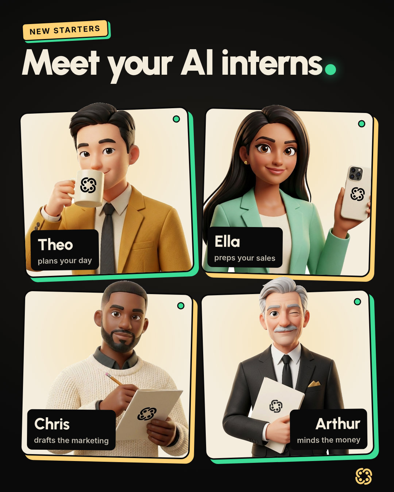
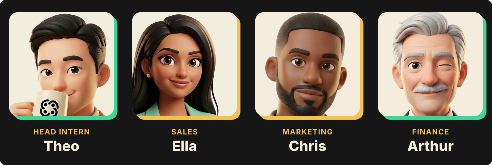
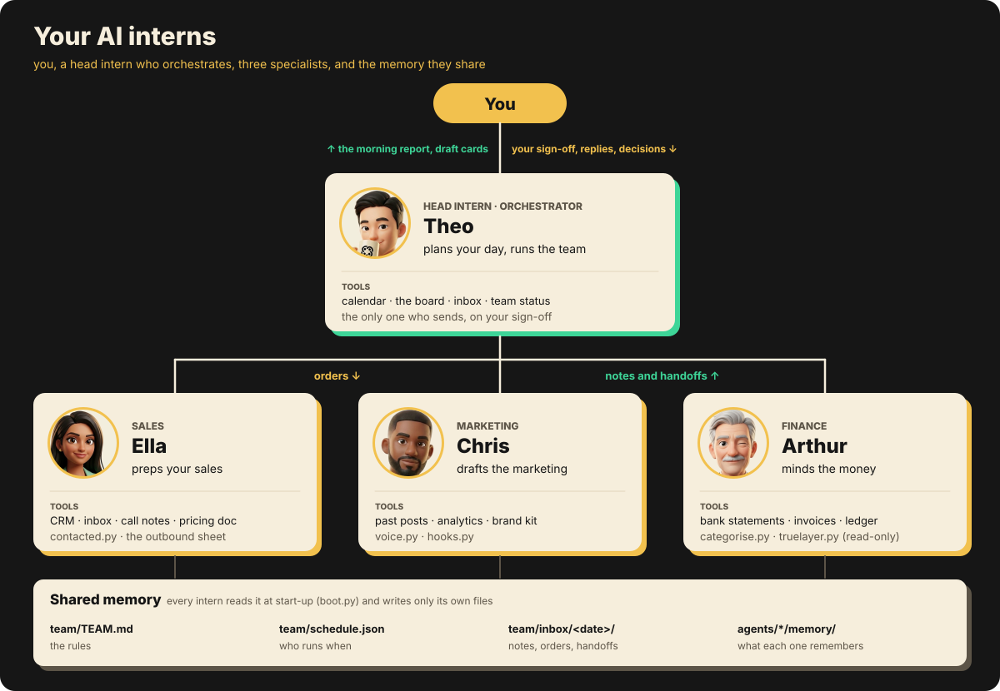
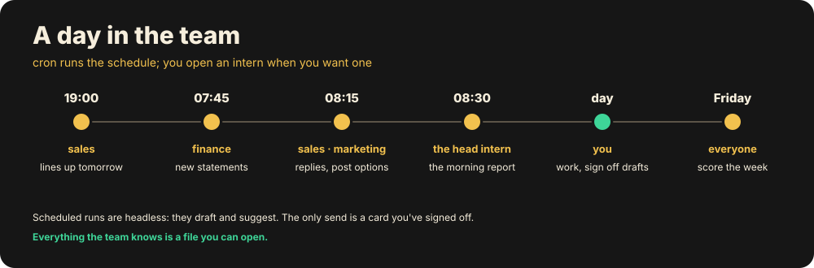
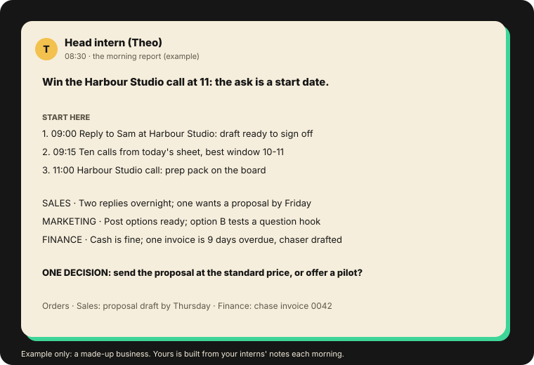
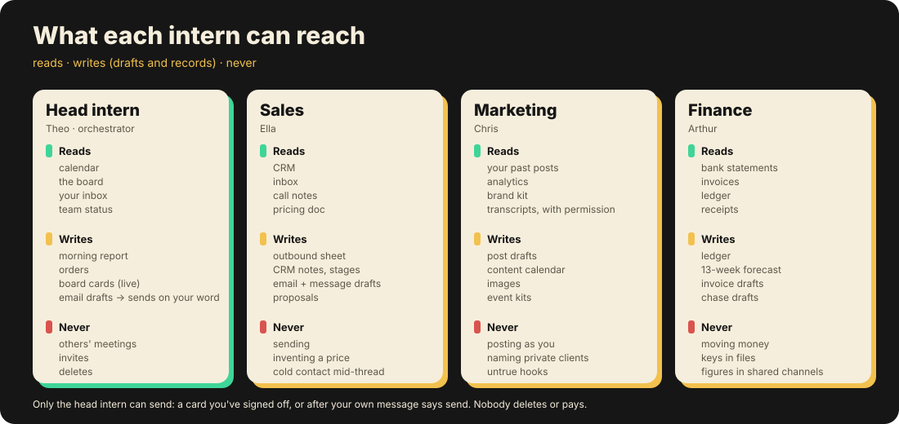
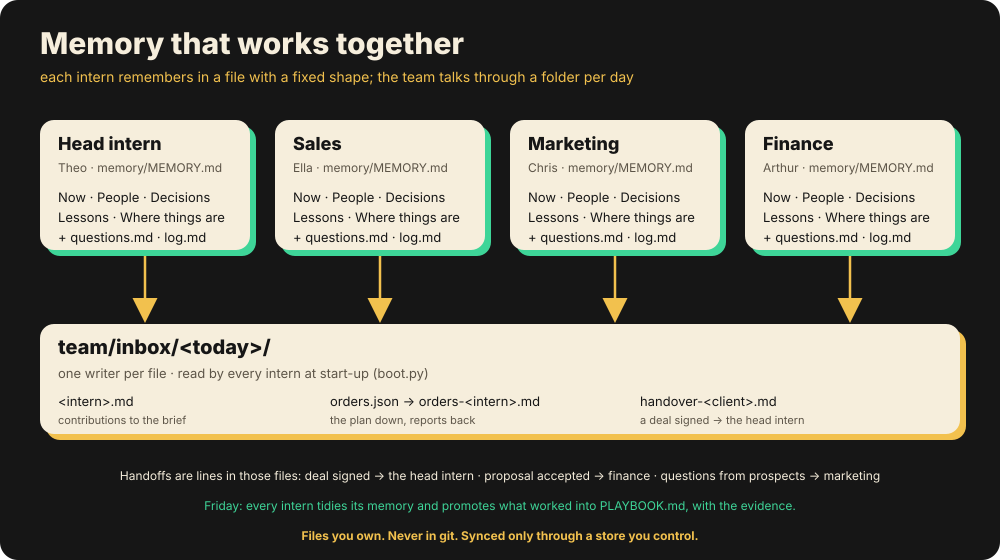
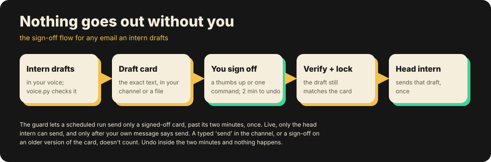
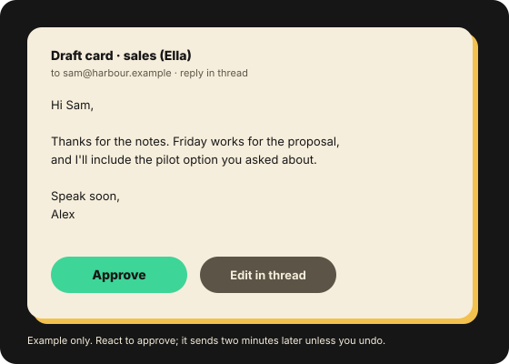
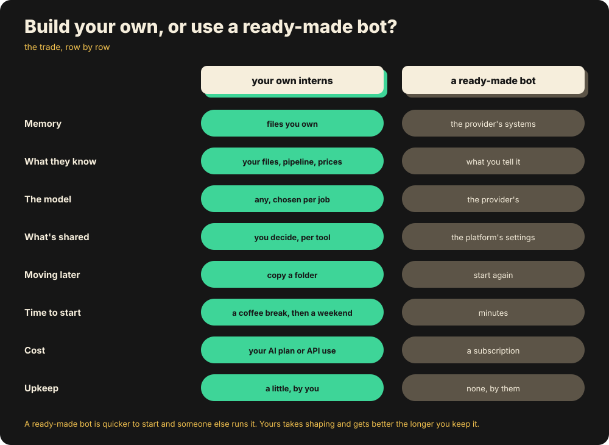

# Agent Intern Starter: your AI interns

Four AI interns who do real work from day one: one plans your day, one preps your sales, another drafts the marketing,
and Arthur minds the money. They have memory, a daily routine, tools and guardrails, and a head intern who
orchestrates the rest and keeps them pointed at your goal. Nothing goes out without your sign-off.



It gives you the building blocks of a working agent team and the wiring between them, so you can build one around
how your business works. It's built for AI coding tools like Claude Code and Codex,
and most of it is plain Python and Markdown, so it works with whichever one you use.

Install them, then onboard them over a coffee.

## Who it's for

Founders, agency owners and anyone running a small business who has tried AI assistants and found they talk but
don't do. The difference here is structure: each intern has a job, a memory, tools it can and can't reach and a time
of day it runs, and the head intern turns four workers into one plan.

## Quick start

You need Python 3.9 or later and an AI coding tool (Claude Code, Codex, Gemini CLI or another). The scripts use only
Python's standard library, so there's nothing else to install.

```sh
git clone https://github.com/co-ordi/agent-intern-starter.git && cd agent-intern-starter
python3 install.py              # three questions: your name, your business in a line, your goal
python3 team/bin/open.py theo   # opens the head intern in your AI tool
```

The head intern (Theo) interviews you on day one and fits the team to your business. Then follow
[docs/first-day.md](docs/first-day.md) for your first day: a morning report, a draft and your first sign-off.

**Not a developer?** Open this folder in your AI coding tool and say *set up my interns*. It reads the code first and
explains what it touches. Once you're happy, it installs everything and opens the head intern.

Run the tests any time: `python3 -m unittest`

### Which AI coding tool

The interns are folders of Markdown and small Python scripts, so any tool that can read files and run commands can
run them. `install.py` picks the first of `claude`, `codex` or `gemini` on your PATH and writes two lines to
`team/team.json`: `"tool"` (what `open.py` starts) and `"runner"` (the headless command scheduled jobs use:
`claude -p`, `codex exec` or `gemini -p`). Each intern's brief is in `AGENTS.md`, the convention Codex and several
other tools read, and in `CLAUDE.md` for Claude Code. Gemini CLI reads `GEMINI.md` by default and can be set to read
`AGENTS.md` too.

What's enforced where, honestly:

- **Everywhere.** The scripts themselves never send an email, delete anything or move money. `approvals.py` holds
  every draft until you sign it off, and only two scripts touch the internet, once you set them up: `slack.py`
  (your own private channel) and the finance intern's read-only bank client.
- **In Claude Code, also by hooks.** The guard (`team/bin/guard.py`) runs before every tool call and blocks sends,
  deletes, payments, secrets in commands and anyone signing off for you, and each intern's deny list switches off
  the tools it must never have.
- **In other tools, as written rules.** Without hooks, the guard's rules are in each intern's brief and the
  interns follow them, but nothing stops a tool call. So `tick.py` only starts the send run for a signed-off card
  under Claude Code; with another tool the card waits in the morning report for you to send. Give interns in other
  tools draft-only access to your email.

To wire another tool's hooks, point its pre-command hook at `team/bin/guard.py <intern>` and its start-up hook at
`team/bin/boot.py <intern>`.

## The team



Theo is the head intern and the orchestrator. He reads every intern's notes, gives each one orders, reconciles what
they say into a single plan and morning report, and is the only intern who can send. The other three each own a lane.

| Intern | What they do | What makes them different |
|---|---|---|
| **Theo**<br>(head intern, orchestrator) | Plans your day: the morning report, orders to the team, the board, the other interns' health, and client delivery with you | Sees everything and is the only one who can send, so he turns four sets of notes into one plan |
| **Ella**<br>(sales) | Preps your sales: the day's outbound sheet (calls, messages and emails, each with a why and a draft), the CRM, follow-ups, proposals | Works from data: an already-contacted check (`tools/contacted.py`) keeps anyone in a live conversation off the cold list, and she learns from every change you make to her sheet |
| **Chris**<br>(marketing) | Drafts the marketing: post options each morning in your voice, the content calendar, images, what gets measured | Writes as you rather than as a bot: `voice.py` checks every draft, and `tools/hooks.py` scores which hook style earns replies, so the playbook keeps what wins |
| **Arthur**<br>(finance) | Minds the money: the books, the 13-week forecast, invoices and chasers, the tax paperwork gathered before anyone asks | The most capable of the four, because he works from your real bank statements (below) |



`install.py` renames them and keeps the roles. Each intern is a folder with `AGENT.md` (who), `OPERATING.md` (what,
when, with what), `PLAYBOOK.md` (defaults with evidence), `memory/`, hooks and its skills, and three of them have a
`tools/` folder of their own.

### The finance intern's extra powers (Arthur)

Money is the one place where the data is already clean, so Arthur goes further than the others.

- **Your bank statements, from day one.** Export a CSV from your online banking and `tools/categorise.py` turns it
  into month-by-month in and out, where the money went and a view per tax year. It lists the merchants no rule
  matched, so he asks you about each one once. Try it on the made-up statement that ships with him:
  `python3 agents/arthur/tools/categorise.py agents/arthur/tools/sample.csv --print`
- **Optionally, your bank connected.** If you'd rather not export, connect your bank through TrueLayer (UK and EU
  open banking; Plaid is the US equivalent) and `tools/truelayer.py` fetches new statements for him, so the books,
  the forecast and the tax paperwork stay current. It's read-only access you approve with your bank and can
  withdraw any time, he can never move money, and your statements are stored only on your machine. Start in
  TrueLayer's free sandbox: [integrations/finance/TRUELAYER.md](integrations/finance/TRUELAYER.md).
- **Gathering, never filing:** he preps the figures for you or your accountant to submit.

## A day in the team



1. **19:00** Sales lines up tomorrow's outbound sheet.
2. **07:45** Finance picks up any new bank statement (on Mondays, the money pulse at 08:45 instead).
3. **08:15** Sales checks overnight replies and marketing drafts the day's post options.
4. **08:30** The head intern writes one morning report from all of it and gives the day's orders.
5. **During the day**, open any intern and it's already up to speed.
6. **Friday** every intern scores its week and updates its playbook with the evidence.

This is roughly what lands at 08:30, for a made-up business:



[docs/example-day/](docs/example-day/) has a full made-up day as files (the sheet, each intern's notes, the report,
the orders and a draft card), and [docs/example-agency/](docs/example-agency/) follows one client from a signed deal
to the first invoice. [docs/wiring.md](docs/wiring.md) has the full picture of how it's wired.

## Running on their own

In this version the interns run on your own computer, so they work while it's on and awake, not around the clock. Until you set this up, they work when you open them. To have them run on their own you need:

- **The schedule.** `team/schedule.json` says who runs what and when, in your timezone.
  `python3 team/bin/tick.py --list` shows the next run of each job.
- **A per-minute runner.** cron or launchd starts `team/bin/tick.py` once a minute. It runs whatever is due, once a
  day each, and the send run for any card you've signed off.
- **A machine that's awake** while they work: your computer with sleep off, or an always-on box such as a spare Mac
  mini or a small cloud server. Running them in the cloud without your machine is on the roadmap.
- **Headless mode.** Each job is one non-interactive run of your AI tool in the intern's folder (the `runner` in
  `team/team.json`), with a time limit. It may use its own folder, the team notes and scripts, and the tools you
  connected in the interview (`"allow"` in `team/team.json`). Nothing else.
- **Stricter rules when nobody's watching.** Scheduled runs are marked as such, and the guard then blocks every send
  except a card you've signed off, every delete, calendar invites, posting as you and git push.
- **A health check.** Each evening the head intern reads every job's status, re-runs what failed and tells you only
  what changes your day.
- **A budget.** Every run uses your AI plan or API credit. Give simple jobs a cheaper model with `"model"` in
  `team/schedule.json`, and keep each job's `timeout_min` tight.

What they do on their own, as shipped in `team/schedule.json`:

| Intern | Runs on its own | What it does unattended | Never unattended |
|---|---|---|---|
| Sales (Ella) | 19:00 Sun-Fri, 08:15 weekdays | Evenings: builds tomorrow's outbound sheet. Mornings: checks replies and moves them to follow-ups, with a draft answer | Sends, deletes, pays |
| Marketing (Chris) | 08:15 weekdays, 17:00 Fridays | Drafts the day's three post options in your voice; on Fridays scores which hook style won | Posts as you, sends, deletes |
| Finance (Arthur) | 07:45 Tue-Fri, 08:45 Mondays | Categorises any new statement; on Mondays the money pulse, flagging overdue invoices | Moves money, pays, sends a chaser |
| Head intern (Theo) | 08:30 weekdays, 19:30 daily, a minute after you sign off a card | Writes the morning report and gives the orders; checks every job's health; sends the one draft you signed off | Sends anything you haven't signed off, deletes, pays |

On Friday afternoons each of them also reviews its week. Unattended, they draft and suggest, and the only thing that
leaves is a draft you've approved.

**cron** (Linux or macOS). Run `crontab -e` and add these two lines, with your own path:

```sh
PATH=/usr/local/bin:/opt/homebrew/bin:/usr/bin:/bin
* * * * * cd /path/to/agent-intern-starter && mkdir -p team/logs && python3 team/bin/tick.py >> team/logs/tick.log 2>&1
```

cron doesn't read your shell profile, so add the folder that `which claude` (or `which codex`) prints to that PATH.

**launchd** (macOS). Save this as `~/Library/LaunchAgents/local.agent-interns.plist`, with your own path:

```xml
<?xml version="1.0" encoding="UTF-8"?>
<!DOCTYPE plist PUBLIC "-//Apple//DTD PLIST 1.0//EN" "http://www.apple.com/DTDs/PropertyList-1.0.dtd">
<plist version="1.0">
<dict>
  <key>Label</key><string>local.agent-interns</string>
  <key>ProgramArguments</key>
  <array>
    <string>/bin/sh</string><string>-c</string>
    <string>cd /path/to/agent-intern-starter &amp;&amp; mkdir -p team/logs &amp;&amp; python3 team/bin/tick.py &gt;&gt; team/logs/tick.log 2&gt;&amp;1</string>
  </array>
  <key>EnvironmentVariables</key>
  <dict><key>PATH</key><string>/usr/local/bin:/opt/homebrew/bin:/usr/bin:/bin</string></dict>
  <key>StartInterval</key><integer>60</integer>
</dict>
</plist>
```

Then `launchctl bootstrap gui/$(id -u) ~/Library/LaunchAgents/local.agent-interns.plist`. On a Mac, keep the folder
outside Documents, Desktop and Downloads (your home folder is fine), because macOS stops background jobs reading
those without extra permission.

## The tools each intern can reach



| Intern | Reads | Writes (drafts and records) | Never |
|---|---|---|---|
| **Head intern**<br>(Theo) | Calendar, the board, your inbox, every intern's status | The report, orders, board cards, email drafts | Deletes, payments, invites, other people's meetings. Sends only a card you've signed off, or when your own message says send |
| **Sales**<br>(Ella) | CRM, inbox, call notes, the pricing document, the contacted log | The outbound sheet, CRM notes, email and message drafts | Sending, deleting, a price that isn't in the pricing document, cold contact mid-conversation |
| **Marketing**<br>(Chris) | Your past posts, analytics, the brand kit | Post drafts, the calendar, images | Posting as you, sending, deleting, naming a private client |
| **Finance**<br>(Arthur) | Bank statements (a CSV export, or optionally a read-only bank connection), invoices, the ledger | The ledger, the forecast, invoice and chase drafts | Moving money, sending, deleting, figures in a shared channel |

Enforced in code: sends, deletes, payments, raw email APIs, secrets in commands and anyone signing off on your
behalf, through the guard and each intern's deny list. Written rules the interns follow (and you see in their
drafts): prices only from the pricing document, private clients unnamed, no figures in shared places. Details, and
how to wire your own tools, are in [docs/tools.md](docs/tools.md).

## Memory that works together



Each intern remembers in `memory/MEMORY.md`, a file with a fixed shape (now, people and deals, your decisions,
lessons, where things are) that it updates in place and you can read in a minute. The team talks through a folder
per day, `team/inbox/<date>/`, with a single writer per file: contributions to the brief, orders down, reports back
and handoffs between interns. `boot.py` loads all of it at the start of every session, so nobody starts from zero,
and the playbooks hold what works, with the evidence, kept honest by the Friday review.
[docs/memory.md](docs/memory.md) has the rules, and
[docs/example-day/MEMORY-after-a-week.md](docs/example-day/MEMORY-after-a-week.md) shows a sales memory after a week.

## Nothing goes out without you



An intern drafts in your voice, and `voice.py` checks it against the phrases you never use. The exact text becomes a
card: in your channel if you've wired one, or in `team/inbox/<date>/cards.md` if not. You sign it off with a 👍 on
the card, or with `python3 team/bin/approvals.py approve --card <id>` in your own terminal. For two minutes nothing
happens, and removing the reaction (or adding `--off`) cancels it. Then `tick.py` starts a short send run for the
head intern: it checks the draft still matches the card, locks it and sends that one draft, once. Change the draft
and the card gets a new version, which needs a new sign-off. An intern can't approve its own drafts through anything
the guard sees, and none of them deletes anything. In a live session, the head intern can also send when your own message tells him to.

The code checks this rather than trusting it. Every sign-off carries evidence the guard checks at send time: your
reaction, still on the card, or a signature only your own terminal can make (on a Mac, it asks for your password
first). Interns can't react, run `approve`, fake a terminal or edit a draft you've signed off. The known limits are
listed in [AGENTS.md](AGENTS.md).



### Why a channel helps (Slack, or any other)

Without a channel everything still works: the interns report in files and you sign off from your terminal. With
one, the morning report lands on your phone, drafts arrive as cards you can sign off from anywhere, you answer an
intern in a thread and it picks the reply up, and you get one quiet channel instead of five dashboards.

The Slack script ships (`team/bin/slack.py`, standard library only), and the pattern is three calls (post a card,
read replies, read reactions), so Microsoft Teams, Discord, Telegram, WhatsApp Business or plain email work the same
way once you write those three for them. [integrations/messaging.md](integrations/messaging.md) covers the set-up.

## Why build your own instead of a ready-made bot



Ready-made bots, such as Grok's, are quick to start and genuinely useful. Building your own gives you:

- **A team that knows your business from day one**, because it reads your own files: calls, prices, pipeline.
- **Memory you can read, edit and move**, kept as plain files on your machine rather than a profile in someone
  else's system.
- **Any model for any job**, including smaller and cheaper ones for simple work.
- **Your own tools**: the CRM, bank statements and calendar you already use, wired the way you want.
- **Guardrails you set**, such as who can send and what's never touched, enforced in code.
- **No per-bot fee** beyond your AI plan and the tools you already pay for.

The honest trade is that a ready-made bot is more polished out of the box and someone else keeps it running. Your
own needs some shaping to fit your business and a little upkeep, and it gets better the longer you keep it.

## What's in the box

```
AGENTS.md             for your AI coding tool: the safety check, then set-up (CLAUDE.md points at it)
install.py            set-up in three questions, or flags for all of it; run again to change an answer
check_private.py      run before you share your own version: checks for private terms and secrets
team/TEAM.md          the rules every intern follows
team/schedule.json    who runs what, when, and on which model (tick.py runs it every minute)
team/bin/             open · boot · guard · orders · brief · tick · approvals · slack · voice · send_ok (each with --test)
team/voice/VOICE.md   how you write; the phrases you never use
agents/<name>/        AGENT.md · OPERATING.md · PLAYBOOK.md · AGENTS.md · memory/ · .claude/ (hooks, skills)
agents/ella/tools/    contacted.py: the already-contacted check and touch log
agents/chris/tools/   hooks.py: which hook style earns replies, for the Friday score
agents/arthur/tools/  categorise.py · categories.json · sample.csv · truelayer.py (optional bank connection)
integrations/         messaging.md · dashboard.md · finance/TRUELAYER.md
docs/                 first-day.md · wiring.md · tools.md · memory.md · example-day/ · example-agency/ · diagrams/
tests/                unittest, stdlib only: python3 -m unittest discover tests
```

## Make them yours

- **The interview.** The head intern's day-one interview fills in most of this for you. Run it again any time
  (`/onboard`) when the business changes.
- **Names and portraits.** `install.py` renames them. For portraits, brief your image tool with the role, the tone
  you want and your own visual style, and keep all four in one style so they read as a team. The ones here were
  made that way, so make your own rather than reusing these.
- **Voice.** `team/voice/VOICE.md` starts from the emails you paste in the interview, then your edits teach it.
- **Tools.** Start with what you already pay for: calendar, inbox, CRM and a bank statement export. Theo connects
  them with you in the interview. See [docs/connect-tools.md](docs/connect-tools.md).
- **The board.** One place that is the truth. See [integrations/dashboard.md](integrations/dashboard.md).
- **A channel.** Optional, and it puts the report and your sign-offs on your phone. See
  [integrations/messaging.md](integrations/messaging.md).

## Roadmap

- **Cloud routines**, so scheduled runs don't need your machine awake, with memory synced through a store you own
  (`team/bin/memsync.md` has the pattern).
- **Smarter model routing.** The schedule already takes a model per job; next is sending each task to the smallest
  model that does it well.
- **TrueLayer Data API v3** for the bank connection, which TrueLayer recommends for new integrations.
- **A dashboard MCP server** you can run in an afternoon.

## How deep this goes

This is a deliberately simple form of an agent. You can read every piece in an afternoon, and nothing is hidden
inside a framework. Each layer can go much further when you need it to:

| Layer | Here | Going deeper |
|---|---|---|
| Memory | Markdown files with a fixed shape | A vector database (pgvector, Chroma, Pinecone) for recall across years of notes, and summarisation that keeps memory short |
| Orchestration, reasoning | Files, hooks and cron | LangGraph (from the LangChain team) for stateful graphs with checkpoints, the Claude Agent SDK for agents written in code with custom tools, or frameworks such as CrewAI |
| Tools | Small scripts and your AI tool's built-in ones | MCP servers that give interns typed access to your CRM, accounting and bank feeds |
| Learning | The playbook and the Friday score | Evaluation sets that score drafts, classifiers that route each task (a small model triaging email intent, for example), and prompt optimisation such as DSPy once you have data |
| Models | One per scheduled job | Smaller or local models for simple jobs, for example through Ollama |

Start simple, see where it strains, and deepen that layer.

## FAQ

**Is it safe?** Ask your AI to check it first; [AGENTS.md](AGENTS.md) tells it how. In short: it runs on your
computer, the interns' memory stays there and out of git, and nothing is sent, deleted or paid without your sign-off.

**Do I need Slack?** No. It works without a channel at all. A channel puts the report and your sign-offs on your
phone, and it can be Slack or almost any other.

**Does it send anything on its own?** Only what you've signed off. Scheduled runs draft; the one thing they send is
a card you approved, once, after the two minutes. In a live session the head intern sends only when your own message
says so.

**Do they run when my laptop's off?** Not in this version. They run on your computer while it's on and awake, or on an always-on machine you leave running. Running in the cloud is on the roadmap.

**Does the finance intern need access to my bank?** No. A CSV statement exported from your online banking is all he
needs. Connecting your bank is an optional extra that keeps the books current without exports.

**What does it cost?** Your AI coding tool's plan or API usage, which scheduled runs draw on too. The kit itself is
free and MIT-licensed, and TrueLayer's sandbox is free (check their pricing before going live).

**Can I use another model or another tool?** Yes. Set a model per scheduled job in `team/schedule.json`, and see
"Which AI coding tool" above for what changes outside Claude Code.

## Troubleshooting

- **An intern starts from zero.** The start-up context didn't load. Open the intern with
  `python3 team/bin/open.py <name>`, or run `python3 team/bin/boot.py <name>` and check that it prints the memory.
- **"Blocked by the team guard".** That's the guard working, and the reason says what to do instead. The rules are at
  the top of `team/bin/guard.py`.
- **Scheduled runs don't happen.** Check the runner from "Running on their own", then run
  `python3 team/bin/tick.py --list` for the next run of each job. Logs are in `team/logs/`.
- **A signed-off card didn't send.** With a tool other than Claude Code, send runs don't start (nothing would
  enforce the guard), so the morning report lists the card for you to send. Otherwise `approvals.py list` shows
  where it stopped.
- **A scheduled run says a tool was denied.** Add the tool's name to `"allow"` in `team/team.json`. Reads and drafts
  only: the guard blocks sends, deletes and payments whatever that list says.
- **Your AI tool isn't found.** Install it, or set `"tool"` and `"runner"` in `team/team.json`.
- **The bank connection says it isn't connected.** Run `truelayer.py link` and `connect <code>` in the same mode as
  the pull (sandbox, or `--live` for both).
- **categorise.py can't find the columns.** It needs a date, a description and either an amount or a paid in and paid
  out pair. Rename the headers if your bank uses other words.

## Privacy

Your interns' memory stays on your machine, and `install.py` keeps it out of git for you. Keys go in your keychain or
environment, never in files. Planning to share your own version? Run `python3 check_private.py` first.

## Licence

MIT.

---

**Want a custom AI build like this for your business?** [CO-ORDI](https://co-ordi.com) makes them.

The CO-ORDI name and mark (on the interns' props and the hero image) aren't
covered by the MIT licence: if you fork this, use your own.
